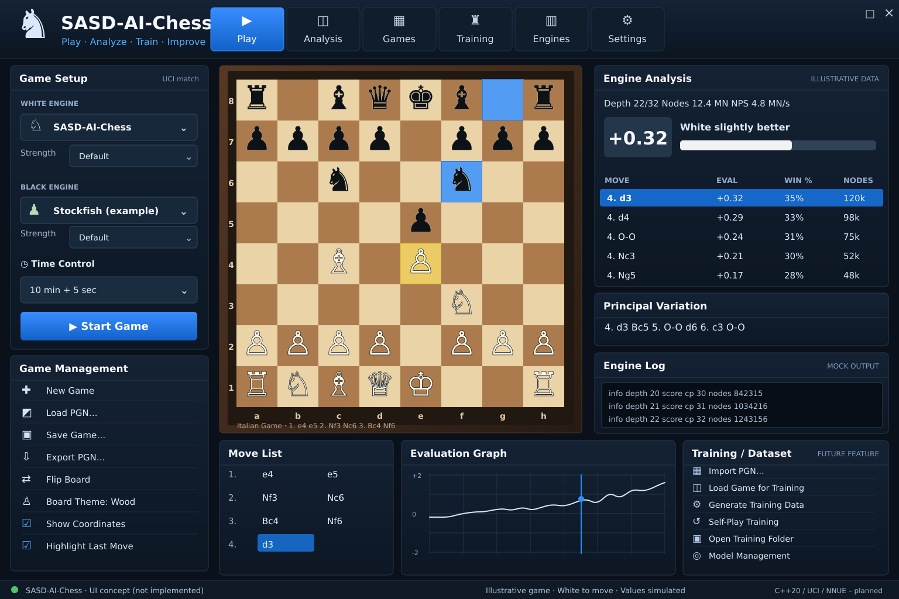
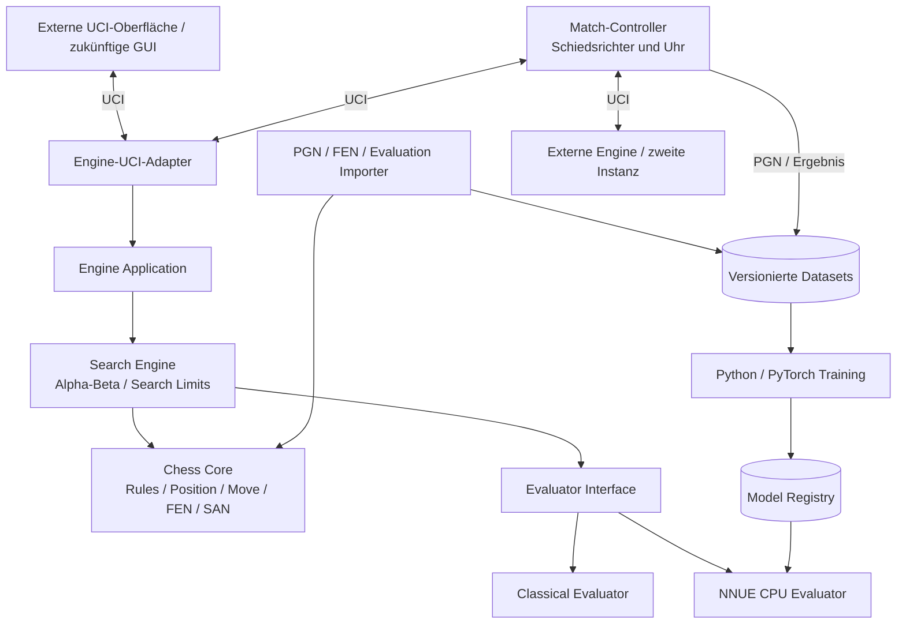
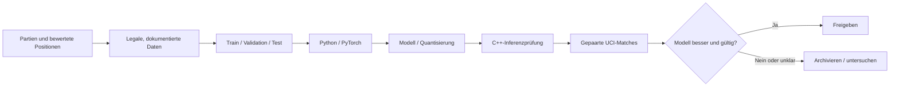

# SASD-AI-Chess

<p align="center">
  <strong>Eine eigenständige, trainierbare Open-Source-Schachengine</strong><br>
  <em>Play · Analyze · Train · Improve</em>
</p>

<p align="center">
  <a href="LICENSE"></a>
  
  
  
  
</p>

> [!IMPORTANT]
> **Aktueller Stand (27. Oktober 2026): M0 – Architektur und Projektfundament.** Die Schachengine ist **noch nicht implementiert**, und es gibt derzeit **keine ausführbare GUI, keine produktive UCI-Schnittstelle, keinen PGN-Importer und kein trainiertes Modell**. Diese README beschreibt das **geplante Zielsystem**, nicht bereits vorhandene Funktionen. Beispielbefehle, Diagramme und Analysewerte sind entsprechend gekennzeichnet. Fortschritte werden in der [Roadmap](ROADMAP.md) nachgewiesen.

**SASD-AI-Chess** ist ein eigenständiges Open-Source-Projekt, in dem wir eine **Schachengine mit eigener, trainierbarer künstlicher Intelligenz** entwickeln. Das Ziel ist nicht nur, eine Engine zu besitzen, die gute Züge findet, sondern ihre Regeln, Suche, Bewertung, Trainingsdaten und Lernfortschritte **technisch und wissenschaftlich nachvollziehen** zu können.

Die erste spielbare Version soll **vollständig offline**, **ohne Python-Laufzeit**, **ohne GPU** und **ohne fremde Schachengine** funktionieren. Neuronale Bewertungsmodelle, automatisiertes Selbstspiel, PGN-Import und Vergleichsturniere kommen schrittweise hinzu.

*English summary: SASD-AI-Chess is an open-source, cross-platform chess-engine and machine-learning research project. It aims to provide a standalone C++20 UCI chess engine, independent engine-vs-engine matches, PGN import, reproducible datasets, Python/PyTorch training and efficient CPU-based neural evaluation. Development is currently in its architecture and planning phase.*

---

## Inhaltsverzeichnis

- [Vorschau der Anwendung](#vorschau-der-anwendung)
- [Vision und Projektziele](#vision-und-projektziele)
- [Geplante Funktionen](#geplante-funktionen)
- [Systemarchitektur](#systemarchitektur)
- [UCI – Kommunikation und Engine-gegen-Engine](#uci--kommunikation-und-engine-gegen-engine)
- [PGN – Partien laden und auswerten](#pgn--partien-laden-und-auswerten)
- [KI-Training und lernfähige Bewertung](#ki-training-und-lernfähige-bewertung)
- [Technologie und Plattformen](#technologie-und-plattformen)
- [Projektstruktur](#projektstruktur)
- [Geplanter Build und CLI](#geplanter-build-und-cli)
- [Teststrategie und Messbarkeit](#teststrategie-und-messbarkeit)
- [Roadmap](#roadmap)
- [Dokumentation](#dokumentation)
- [Mitarbeit und Sicherheit](#mitarbeit-und-sicherheit)
- [Lizenz und Datenquellen](#lizenz-und-datenquellen)

## Vorschau der Anwendung

<p align="center">
  
</p>

<p align="center"><em>Konzeptansicht einer möglichen zukünftigen SASD-AI-Chess-Oberfläche – keine Aufnahme einer bereits laufenden Anwendung.</em></p>

Die Vorschau zeigt die gewünschte Richtung: Eine übersichtliche Desktop-Anwendung mit Schachbrett, Engine-Auswahl, Zugliste, Analyse, PGN-Verwaltung und Werkzeugen für Trainingsdaten. **Die im Bild gezeigten Messwerte und Bedienelemente sind simuliert und nicht funktionsfähig.** Die eingebundene SVG-Grafik ist eine für GitHub aufbereitete Darstellung des Oberflächenkonzepts.

> **Architekturentscheidung:** Eine eigene Desktop-GUI ist für die erste Engine-Version **kein Pflichtbestandteil**. Wir entwickeln zuerst eine saubere, unabhängig nutzbare **C++-Engine mit UCI** sowie eigenständige Werkzeuge für Matches und Training. Dadurch bleibt die Engine mit anderen Schachoberflächen kompatibel; eine spätere GUI wird über definierte Schnittstellen angebunden.

## Vision und Projektziele

SASD-AI-Chess soll ein verständliches, erweiterbares Fundament für **klassische Schachalgorithmen** und **modernes maschinelles Lernen** schaffen. Jede Änderung soll sich überprüfen lassen: Funktioniert die Engine regelkonform? Wird sie schneller? Bewertet sie Stellungen präziser? Spielt sie tatsächlich stärker?

Unsere Leitprinzipien sind:

1. **Korrektheit vor Geschwindigkeit.** Der Chess Core muss alle Standard-Schachregeln inklusive Rochade, en passant, Bauernumwandlung, Matt/Patt und Remis korrekt behandeln. Erst danach werden interne Darstellungen und Suchalgorithmen optimiert.
2. **Saubere Architektur statt Funktionsansammlung.** Schachregeln, Suche, Bewertung, UCI, Match-Leitung, Datenimport und Training bleiben getrennte Verantwortlichkeiten.
3. **Portabel und offline-first.** Die fertige Engine benötigt keine Cloud, keinen externen Schachserver, keine Python-Installation und keine GPU.
4. **Offene Standards und Interoperabilität.** UCI für laufende Zugkommunikation; FEN/SAN/PGN für Stellungen und gespeicherte Partien.
5. **Reproduzierbare Forschung.** Datasets, Modelle und Experimente erhalten eindeutige Versionen, Einstellungen und Messprotokolle.
6. **Verständliche Entwicklung.** Kommentierter Quellcode, dokumentierte Entscheidungen und automatisierte Tests sind Teil jeder Lieferung.

### Verhältnis zu SASD-Chess

**SASD-AI-Chess** ist dieses Repository mit der trainierbaren Schachengine. Das separate Projekt **SASD-Chess** ist **weder Untermodul noch Laufzeitabhängigkeit**. Über UCI sollen beide Programme später trotzdem miteinander spielen können, sobald beide die entsprechende Schnittstelle unterstützen.

## Geplante Funktionen

| Baustein | Fähigkeiten | Geplanter Meilenstein |
| --- | --- | --- |
| **Chess Core** | Brett, Figuren, legale Züge, Historie, FEN/SAN, Spielende | M1 |
| **Search Engine** | iterative Vertiefung, Alpha-Beta, Quiescence, Transposition Table, Zeitlimits | M2 |
| **Classical Evaluation** | nachvollziehbare Stellungsbewertung als stabile Baseline | M2 |
| **UCI** | standardisierte Kommunikation mit GUI und anderen Schachengines | M2 |
| **Match Controller** | zwei UCI-Prozesse, Uhr, Schiedsrichter, PGN, Engine-Selbstspiel | M3 |
| **PGN Importer** | Partien importieren, Züge rekonstruieren, prüfen, wiedergeben | M4 |
| **Dataset Pipeline** | Filter, Quarantäne, Dubletten, Training/Validation/Test, Manifest | M4 |
| **Neural Evaluation** | eigenes kleines NNUE-artiges Netz, CPU-Inferenz in C++ | M5 |
| **Model Training** | Python/PyTorch, Feature-Encoder, Export, Versionsverwaltung | M5 |
| **Evaluation Lab** | Engine-Vergleiche, gepaarte Partien, Elo-/Unsicherheitsauswertung | M6 |
| **Self-Play Training** | automatische Datengewinnung und kontrollierte Modellpromotion | M7 |
| **Desktop-Oberfläche / verteiltes Training** | optionale spätere Erweiterungen | noch nicht terminiert |

**Wichtig:** Diese Tabelle ist **keine Liste bereits implementierter Funktionen**. Für den Ist-Stand ist die [Roadmap](ROADMAP.md) maßgeblich.

## Systemarchitektur

Das Projekt folgt einer **modularen Ports-and-Adapters-Architektur**. Die Schachregeln sind unabhängig von Protokollen, Dateien, Trainingsbibliotheken und Oberflächen. Die Engine nutzt nur typisierte interne Schnittstellen; Trainingswerkzeuge arbeiten außerhalb des Engine-Prozesses.



**Chess Core:** einzige fachliche Implementierung der Standardregeln; kennt keine neuronalen Netze, keine GUI und kein UCI. **Search Engine:** berechnet Züge, kann unterbrochen werden und verwendet einen austauschbaren Evaluator. **UCI-Adapter:** setzt Textkommandos in Anwendungsbefehle um. **Match-Controller:** eigener Prozess und **autoritative** Partieinstanz, die jeden gelieferten Zug prüft. **Importer/Trainer:** erzeugen und verarbeiten reproduzierbare Daten- und Modellartefakte.

Alle Details mit Modulgrenzen, Entscheidungen und Risiken enthält [docs/ARCHITEKTUR.md](docs/ARCHITEKTUR.md).

## UCI – Kommunikation und Engine-gegen-Engine

Für den laufenden Zugtausch setzen wir auf **Universal Chess Interface (UCI)**. Die Engine wird als eigenständiges Programm über **stdin/stdout** mit einer Oberfläche oder einem Match-Controller kommunizieren. Damit ist nicht für jede fremde Engine eine proprietäre Integration nötig.

**Geplanter UCI-Dialog (Beispiel, noch nicht ausführbar):**

```text
> uci
< id name SASD-AI-Chess
< id author SASD
< uciok
> isready
< readyok
> ucinewgame
> position startpos moves e2e4 e7e5 g1f3 b8c6
> go movetime 1000
< info depth 5 score cp 20 nodes 12000 pv f1c4
< bestmove f1c4
```

Die Werte und Antworten sind **illustrativ**, keine aus SASD-AI-Chess gemessenen Ergebnisse.

### Zwei getrennte Engines gegeneinander

Eine UCI-Engine ist **kein Schiedsrichter** und UCI selbst **kein Peer-to-Peer-Matchprotokoll**. Deshalb erhält SASD-AI-Chess einen separaten **Match-Controller**:

```text
                SASD-AI-Chess Match Controller
                    (Board · Clock · Arbiter)
                        /         \
                 UCI   /           \   UCI
                      v             v
                Engine A         Engine B
               White / PID A    Black / PID B
                      \             /
                       \           /
                       PGN / Result
```

Beide Engines werden als **unabhängige Prozesse** gestartet. Das kann zweimal dieselbe SASD-AI-Chess-Datei sein, zweimal eine andere Version oder SASD-AI-Chess gegen beispielsweise Stockfish. Die Match-Leitung verwaltet Schachstellung, Zugfolge, Zeitkontrolle, Regelverstöße, Prozessabstürze und Ergebnis. Jede Partie wird für Analyse und spätere Trainingsexperimente protokolliert.

Siehe [docs/PROTOKOLLE.md](docs/PROTOKOLLE.md).

## PGN – Partien laden und auswerten

Um aus gespeicherten Schachpartien zu lernen, verwenden wir **Portable Game Notation (PGN)**. Das Format enthält Spieler, Veranstaltung, Ergebnis und die Zugfolge als **SAN**. Der Importer soll Partien einzeln, gesammelt und später auch **streamend aus komprimierten Archiven** verarbeiten können.

**Kleines PGN-Beispiel:**

```pgn
[Event "SASD Training Example"]
[Site "?"]
[Date "2026.10.27"]
[Round "?"]
[White "Example White"]
[Black "Example Black"]
[Result "*"]

1. e4 e5 2. Nf3 Nc6 3. Bc4 Nf6 *
```

Die Datenpipeline rekonstruiert aus jedem legalen Zug den Zustand des Schachbretts und kann daraus **Positionen und Lernbeispiele** erzeugen. Unvollständige oder fehlerhafte Partien werden nicht stillschweigend korrigiert: Quelle, Fehlerposition und Grund werden protokolliert. Importfilter, Dublettenprüfung, Quelllizenzen und Aufteilung in unabhängige Trainings-/Validierungs-/Testgruppen sind Teil der Architektur.

### Quellen für Schachpartien

- **[Lichess Open Database](https://database.lichess.org/):** große offene Partiensammlungen als PGN/Zstandard-Archive; konkrete Lizenz der verwendeten Sammlung prüfen.
- **Lichess-Evaluationsdaten:** bereits analysierte Stellungen; gesonderter JSONL-Importer mit Prüfung der Score-Perspektive vorgesehen.
- **[The Week in Chess](https://theweekinchess.com/twic):** Turnierpartien; Nutzungsbedingungen **getrennt** prüfen.
- **Eigene Matchdaten:** künftig PGN und Ergebnisse des Match-Controllers.

Ein PGN-Zug ist **nicht automatisch ein optimaler Zug**. Deshalb unterscheiden wir **Zugimitation** (was wurde gespielt?) von **Stellungsbewertung** (wie gut ist die Stellung?). Für die zweite Aufgabe brauchen wir geeignete Bewertungslabels oder kontrollierte Selbstspielergebnisse.

Mehr dazu in [docs/DATENQUELLEN.md](docs/DATENQUELLEN.md); die Importanforderung ist in [GitHub Issue #1](https://github.com/Robin-Goerlach/SASD-AI-Chess/issues/1) festgehalten.

## KI-Training und lernfähige Bewertung

Wir beginnen mit einer **klassischen Suchengine** und einem einfachen, unabhängigen Evaluator. Danach trainieren wir ein **kleines NNUE-artiges Netzwerk**, das Schachstellungen bewertet und ohne Python in der C++-Engine laufen kann.



Die drei langfristigen Lernwege:

1. **Imitation Learning:** Mit Partien lernen, welche Züge Menschen oder Referenzengines wählen.
2. **Supervised Value Learning:** Ein Netz darauf trainieren, bewertete Stellungen mit konsistenten Centipawn-/Mate-/WDL-Labels einzuschätzen.
3. **Self-Play:** Eigene Engine-Versionen spielen, erzeugen neue Beispiele, trainieren Kandidaten und messen anschließend deren Spielstärke.

**Jedes Modell wird versioniert.** Ein Trainingslauf dokumentiert Quellcode-Commit, Datensatz-/Modellhashes, Feature-Schema, Labels, Splits, Seeds, Hyperparameter, Hardware und Ergebnisse. Eine niedrigere Trainings-Loss ist **kein Ersatz** für unabhängige Spielstärketests unter gleichen Bedingungen. Neue Modelle werden nur nach **vorher festgelegten Qualitätskriterien** freigegeben.

Forschungs- und Datenvertrag: [docs/TRAINING.md](docs/TRAINING.md).

## Technologie und Plattformen

| Bereich | Vorgesehene Technologie | Begründung |
| --- | --- | --- |
| Engine, Regeln, Suche | **C++20** | portable, schnelle Runtime und klare Daten-/Speicherkontrolle |
| Match-Controller, Importer | **C++20** | gemeinsam geprüfte Schachlogik; eigenständige Prozesse |
| Build und Tests | **CMake / CTest** | etablierter Cross-Platform-Build |
| Trainieren, Modell-Export | **Python / PyTorch** | flexible Experimente, automatische Differenzierung |
| Öffentliche Schachformate | **UCI, FEN, SAN, PGN** | bekannte, unabhängig testbare Austauschstandards |
| Artefakte | Dataset-/Modell-Manifeste, Hashes, Shards | Herkunft, Prüfbarkeit und Reproduzierbarkeit |
| Zielplattformen | **Windows · Linux · FreeBSD · OpenBSD** | möglichst portabel; Unterstützung durch echte Builds zu belegen |

**Zielregel:** Zur Laufzeit wird für die Engine **kein Python, kein PyTorch, kein Cloud-Dienst und keine GPU** benötigt. Die konkrete Wahl zusätzlicher Parser-/Kompressionsbibliotheken steht unter Architektur- und Lizenzprüfung.

## Projektstruktur

Die in der [Architektur](docs/ARCHITEKTUR.md) vorgeschlagene Struktur wird **erst in den jeweiligen Meilensteinen aufgebaut**. Die folgende Darstellung ist **eine Zielstruktur, kein Verzeichnislisting des aktuellen Repositorys**:

```text
SASD-AI-Chess/
├── apps/
│   ├── engine/              # planned: standalone UCI executable
│   ├── match/               # planned: match and tournament controller
│   └── dataset/             # planned: PGN import CLI
├── include/sasd/chess/      # planned: public C++ interfaces
├── src/
│   ├── core/                # planned: position, moves, rules
│   ├── search/              # planned: search service
│   ├── evaluation/          # planned: classical / NNUE
│   ├── protocol/uci/        # planned: UCI parser and writer
│   ├── match/               # planned: process and clock handling
│   └── dataset/             # planned: PGN and evaluations import
├── training/                # planned: Python/PyTorch
├── tests/                   # planned: unit, perft, integration
├── docs/
│   ├── ARCHITEKTUR.md       # available
│   ├── images/              # UI concept
│   └── adr/                 # architecture decisions
├── ROADMAP.md               # available
├── AGENTS.md                # available
├── README.md                # this document
└── LICENSE                  # MIT
```

## Geplanter Build und CLI

> [!WARNING]
> **Noch nicht ausführbar.** Die nachfolgenden Befehle sind **Entwürfe für den zukünftigen Workflow**, sobald M0 das CMake-Projekt erstellt und die jeweiligen Programme implementiert hat. Zurzeit besitzt das Repository noch keine `CMakeLists.txt` und keine ausführbare Engine.

### Entwicklungsumgebung (künftig)

- C++20-fähiger Compiler (beispielsweise GCC, Clang oder MSVC)
- CMake und passendes Buildsystem
- Optional: eine externe UCI-Engine zum Integrationstest
- Erst für Training: separate Python-/PyTorch-Umgebung

```bash
git clone https://github.com/Robin-Goerlach/SASD-AI-Chess.git
cd SASD-AI-Chess

# Planned after M0:
cmake -S . -B build/debug -DCMAKE_BUILD_TYPE=Debug
cmake --build build/debug
ctest --test-dir build/debug --output-on-failure
```

Bei Multi-Config-Generatoren (beispielsweise MSVC) werden `--config Debug` für den Build und `-C Debug` für CTest verwendet.

### Kommandozeilenbeispiele (künftige CLI, noch nicht implementiert)

```bash
# Engine via standard input/output in UCI mode:
sasd-ai-chess

# Run two independent instances as White and Black:
sasd-ai-chess-match --white ./sasd-ai-chess --black ./sasd-ai-chess

# Import saved PGN games into a versioned dataset:
sasd-ai-chess-dataset import --input games.pgn --output data/games

# Train a small neural position evaluator:
sasd-ai-chess-train --dataset data/games --model nnue-small
```

Die tatsächliche Optionssyntax wird **erst bei der Implementierung** festgelegt und dokumentiert.

## Teststrategie und Messbarkeit

Schachengine-Tests sind vor allem **Korrektheitsprüfungen**. Deshalb gehen Perft- und Spezialregeltests der KI-Optimierung voraus.

| Testbereich | Kernfragen | Status |
| --- | --- | --- |
| **Chess Core** | Legale Züge, Schachschutz, Rochade, en passant, Promotion, Historie, Remis | geplant |
| **Perft** | Startstellung Tiefe 1–4: **20 / 400 / 8.902 / 197.281** Zugknoten | geplant |
| **UCI** | Handshake, Position, Suche, `stop`, EOF, genau ein `bestmove` | geplant |
| **Match** | zwei Prozesse, Uhren, Legalität, Abbruchfälle, PGN-Ergebnis | geplant |
| **Import** | SAN/FEN/PGN, ungültige Daten, Streaming, Filter, Dubletten, Splits | geplant |
| **Modelle** | Feature-Parität, Quantisierung, Export/Import, C++-Inferenz | geplant |
| **Spielstärke** | gepaarte Partien, Farbtausch, definierte Zeitkontrollen, Unsicherheit | geplant |
| **Portabilität** | reale Windows-/Linux-/BSD-Debug- und Release-Builds | noch nicht geprüft |

Performance-Zahlen wie Nodes/s, Trainingsdauer oder Elo werden **nicht geschätzt und anschließend als Messung ausgegeben**. Für jeden bestätigten Fortschritt werden Testumgebung, Commit, Kommandos und Ergebnisse festgehalten.

Das vollständige Testkonzept steht in [docs/TESTKONZEPT.md](docs/TESTKONZEPT.md).

## Roadmap

| Phase | Ergebnis | Stand (27.10.2026) |
| --- | --- | --- |
| **M0** | Dokumentation, Build-/Testfundament | 🟡 Dokumentation vorhanden; kompilierbares Fundament fehlt |
| **M1** | regelkonformer Chess Core | ⬜ geplant |
| **M2** | spielende klassische Engine und UCI | ⬜ geplant |
| **M3** | Engine-gegen-Engine und Schiedsrichter | ⬜ geplant |
| **M4** | PGN-Importer und Trainingsdaten | ⬜ geplant |
| **M5** | erstes selbst trainiertes NNUE-artiges Modell | ⬜ geplant |
| **M6** | Elo-/Modellvergleich und Qualitätsgates | ⬜ geplant |
| **M7** | automatisierte Selbstspiel-Trainingsschleife | ⬜ geplant |

**Nächster Entwicklungsschritt:** CMake-Projekt und ein erster kompilierender C++-Test (M0), darauf aufbauend ein sauber getesteter Chess Core. Abnahmekriterien, Abhängigkeiten und Statusdefinitionen: [ROADMAP.md](ROADMAP.md).

## Dokumentation

| Dokument | Zweck |
| --- | --- |
| [ARCHITEKTUR.md](docs/ARCHITEKTUR.md) | Modulgrenzen, Schichten, Datenflüsse und Risiken |
| [ROADMAP.md](ROADMAP.md) | Meilensteine, Fortschritt, Abnahme |
| [LASTENHEFT.md](docs/LASTENHEFT.md) | fachliche Anforderungen – **was** benötigt wird |
| [PFLICHTENHEFT.md](docs/PFLICHTENHEFT.md) | technische Erfüllung – **wie** umgesetzt wird |
| [PROTOKOLLE.md](docs/PROTOKOLLE.md) | UCI, Match-Controller, PGN/FEN und Datenverträge |
| [TRAINING.md](docs/TRAINING.md) | Datensätze, Modelle, Training, Freigabe |
| [DATENQUELLEN.md](docs/DATENQUELLEN.md) | offene PGN-/Bewertungsdaten und Lizenzregeln |
| [TESTKONZEPT.md](docs/TESTKONZEPT.md) | Unit-, Protokoll-, Match-, Import- und KI-Tests |
| [Architekturentscheidungen](docs/adr/README.md) | einzelne ADRs mit Alternativen und Konsequenzen |
| [AGENTS.md](AGENTS.md) | Richtlinien für Coding Agents |
| [CONTRIBUTING.md](CONTRIBUTING.md) | Regeln zur Mitarbeit und Qualität |
| [SECURITY.md](SECURITY.md) | Umgang mit unsicheren Daten und fremden UCI-Prozessen |
| [CHANGELOG.md](CHANGELOG.md) | Änderungen und Versionen |

## Mitarbeit und Sicherheit

Beiträge zu C++-Code, Python-Training, Schach-Teststellungen, Dokumentation, Vergleichstests und Datenschnittstellen sind willkommen. Bitte vor Änderungen [CONTRIBUTING.md](CONTRIBUTING.md) und [AGENTS.md](AGENTS.md) beachten. Öffentliche C++-Schnittstellen erhalten **ausführliche englische Doxygen-Kommentare**, komplexe Implementierungsentscheidungen verständliche englische Inline-Kommentare. Die Fach- und Architekturunterlagen sind primär deutschsprachig.

Heruntergeladene PGN-/FEN-/JSONL-Dateien gelten als **nicht vertrauenswürdige Eingaben**. Fremde UCI-Engines sind **ausführbare Programme** und werden nur bewusst gestartet. Trainingsdaten, Modellgewichte, API-Tokens und große Archive sollen nicht unbeabsichtigt ins Repository gelangen; weitere Vorgaben enthält [SECURITY.md](SECURITY.md).

## Lizenz und Datenquellen

Der eigene Repository-Code steht unter **[MIT](LICENSE)**, Copyright © 2026 **Robin Goerlach (SASD-GmbH)**. Die MIT-Lizenz des Projekts erstreckt sich **nicht automatisch** auf fremde Schachengines, PGN-Sammlungen, Modellgewichte oder importierte Bibliotheken. Lizenz, Herkunft und gegebenenfalls Weiterverbreitungsrechte dieser Inhalte müssen eigenständig geprüft werden.

---

<p align="center">
  <strong>SASD-AI-Chess</strong><br>
  <em>Eine Schach-KI entwickeln · verstehen · trainieren · messen</em><br><br>
  <a href="ROADMAP.md">Roadmap</a> ·
  <a href="docs/ARCHITEKTUR.md">Architektur</a> ·
  <a href="docs/TRAINING.md">KI-Training</a> ·
  <a href="https://github.com/Robin-Goerlach/SASD-AI-Chess/issues">Issues</a>
</p>
