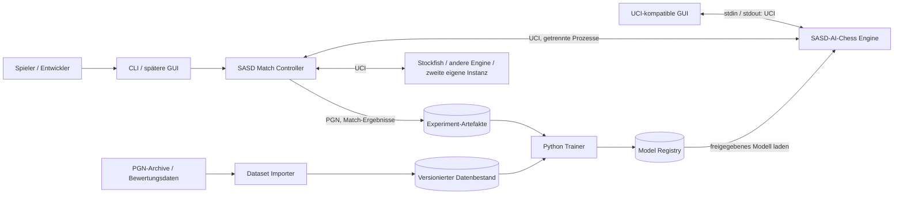
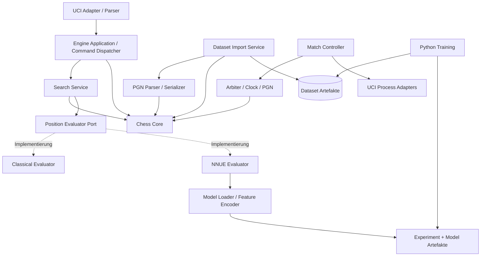
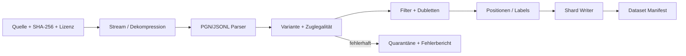
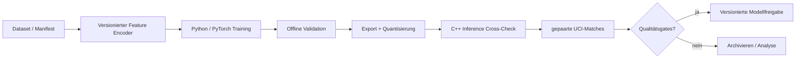

# SASD-AI-Chess – Softwarearchitektur

> **Dokumentenstatus:** Entwurf zur technischen Baseline (Version 0.1)  
> **Stand:** 27. Oktober 2026  
> **Projekt:** SASD-AI-Chess · Repository: https://github.com/Robin-Goerlach/SASD-AI-Chess  
> **Geltungsbereich:** eigenständige KI-Schachengine, Interoperabilität, Partienimport und reproduzierbare KI-Forschung  
> **Implementierungsstand:** Dieses Dokument beschreibt die geplante Architektur; es behauptet keine bereits implementierten Komponenten.

## 1. Zweck und Leitbild

SASD-AI-Chess wird eine **eigenständig entwickelte, quelloffene und plattformübergreifende Schachengine mit trainierbarer Stellungsbewertung**. Das Projekt soll nicht nur gute Züge finden, sondern die wissenschaftliche Frage beantwortbar machen, **ob, weshalb und unter welchen Bedingungen eine Änderung die Spielstärke verbessert**.

Die Engine muss **ohne Python, GPU, Netzwerkzugang oder fremde Schachengine spielbar** bleiben. Training und Auswertung dürfen leistungsfähigere Werkzeuge verwenden, sind aber *nicht* Laufzeitabhängigkeiten der spielenden Engine.

Zwei konkrete Nutzeranforderungen sind architekturbestimmend:

1. **Engines koppeln:** SASD-AI-Chess spielt mittels **UCI** gegen beliebige kompatible Programme, gegen **SASD-Chess** (separates Projekt, sobald es UCI unterstützt) und gegen eine zweite, unabhängig gestartete eigene Instanz. Ein separater Match-Controller organisiert die Partien.
2. **Aus Partien lernen:** Einzelne oder massenhaft heruntergeladene **PGN-Partien** lassen sich prüfen, wiedergeben, analysieren und in reproduzierbare Trainingsbestände umwandeln. Bereits bewertete Stellungen werden über gesonderte Adapter importiert.

**Abgrenzung:** SASD-Chess (ohne KI) und SASD-AI-Chess (mit trainierbarer KI) sind unterschiedliche Repositories und Produkte. SASD-UI-Toolkit ist **keine** zwingende Abhängigkeit. Dieses Dokument ist die Architektur-Baseline, kein Ersatz für Lastenheft, Pflichtenheft oder einzelne ADRs.

## 2. Qualitätsziele und Prioritäten

Die Priorität lautet: **Korrektheit > reproduzierbare Messbarkeit > Verständlichkeit/Wartbarkeit > Interoperabilität > Performance > zusätzliche Funktionen**.

| Priorität | Qualitätsziel | Architekturfolge |
| --- | --- | --- |
| P0 | Regelkonformes Schach | Eine geprüfte Regel- und Stellungsimplementierung; Perft- und Referenztests vor KI-Optimierung |
| P0 | UCI-Interoperabilität | Strikte Trennung von Protokoll, Anwendung und Suche; keine Statusmeldungen außerhalb des UCI-Protokolls auf stdout |
| P0 | Reproduzierbare Experimente | Versionierte Trainingsdaten/Modelle, Seeds, Hashes, Konfigurationen und Match-Ergebnisse |
| P0 | Prozessrobustheit | Eigener Match-Controller mit Zeitkontrolle, Schiedsrichterlogik, Timeouts und Absturzbehandlung |
| P1 | Testbarkeit | Kleine Abhängigkeitsschnittstellen, deterministische Tests und getrennte Integrationsprüfungen |
| P1 | Portabilität | C++20, CMake, Standardbibliothek soweit sinnvoll; Windows, Linux und BSD als Zielplattformen |
| P1 | Ressourcenschonung | Streaming-Import, begrenzte Queues, CPU-Inferenz kleiner Modelle |
| P2 | Trainingsskalierung | Später parallele Worker, GPU-Training und verteilte Match-Ausführung ohne Änderung des Chess Core |

**Nichtziele für die erste Version:** eigene GUI, Schachvarianten (insbesondere Chess960), Cloud-Dienst, permanenter Webserver, verteiltes Training, vollständige Stockfish-Spielstärke, selbsttätige Netzwerk-Downloads im Engine-Prozess, dynamisch nachladbare C++-Plugins/ABI.

## 3. Systemkontext und Grenzen



**Verantwortungsgrenzen:**

- **Engine:** entscheidet über einen legalen Zug innerhalb vorgegebener Suchlimits; liest keine beliebigen Internetdaten und trainiert nicht zur Laufzeit.
- **Chess Core:** besitzt die Regeln und Zustandsübergänge, kennt weder UCI noch neuronale Netze.
- **Match-Controller:** hält die *autoritative* Partie und Uhren, kontrolliert externe Prozesse, beurteilt Regel- und Zeitverstöße.
- **Datenpipeline:** importiert *nicht vertrauenswürdige* externe Dokumente, validiert diese und erzeugt fest definierte Trainingsbeispiele.
- **Trainer:** trainiert Modelle und erzeugt unveränderliche Kandidaten; darf kein laufendes Turnier stillschweigend umkonfigurieren.
- **Evaluation/Promotion:** entscheidet anhand vorab definierter Prüfungen über die Freigabe eines Modells.

**Sicherheitsgrenze:** heruntergeladene PGN-/JSONL-Dateien sind Daten, **keine ausführbaren Anweisungen**. Fremde UCI-Engines sind ausführbare Programme, die nur nach expliziter Konfiguration gestartet werden.

## 4. Architekturprinzipien

1. **Ports-and-Adapters (hexagonal) + modulare Monolithen:** fachliche Logik über stabile C++-Schnittstellen; Prozesse nur dort trennen, wo Isolation oder Laufzeitunabhängigkeit notwendig ist.
2. **Abhängigkeitsrichtung nach innen:** Protokoll, Import, CLI und Prozessadapter hängen vom fachlichen Kern ab; der Kern hängt von keinem Adapter ab.
3. **Eine Wahrheit für Schachregeln:** Engine, Parser und Match-Controller teilen die *fachliche Semantik* des Chess Core. Der Controller verwaltet dennoch seinen eigenen autoritativen Spielzustand.
4. **Explizite Versionierung über Systemgrenzen:** UCI/PGN/FEN als etablierte Austauschformate; interne Datasets, Feature-Encoder und Modelldateien mit eigener `schema_version`.
5. **Kein Training im Engine-Hotpath:** rechenintensive Datenvorbereitung/Backpropagation ausschließlich außerhalb der Engine.
6. **Messbarkeit vor Optimierung:** Verbesserungen erst nach isolierbaren Benchmarks, Gegenproben und Match-Evaluation übernehmen.
7. **Einfach beginnen, ohne Erweiterbarkeit zu verbauen:** kein vorschnelles Verteilungsframework oder allgemeines Plugin-System.

## 5. Bausteinsicht (logische Komponenten)



### 5.1 Chess Core (C++, ohne externe KI-Abhängigkeit)

**Verantwortung:** Position, Figuren, Zugtypen, legaler Zug, Rochade, en passant, Bauernumwandlung, Schach/Schachmatt, Patt, Wiederholungen, Remisregeln und FEN/SAN/UCI-Zugnotation.

**Begriffliche Verträge:**

- `Position`: Brettstellung, Zugrecht, Rochaderechte, en-passant-Ziel, Halbzugzähler, Zugnummer; keine UI- oder Trainingsfelder.
- `Move`: Von-/Nach-Feld, mögliche Umwandlung, interne Flags; interne Kodierung verborgen.
- `GameHistory`: für Drei-/Fünffachwiederholung, Halbzugregel und revisionsfähige Partiegeschichte; **nicht** bloß eine einzelne FEN.
- `MoveGenerator`: zunächst pseudo-legale Züge und Legalitätsfilter; später optimierbare Implementierung hinter stabiler API.
- `Rules/Outcome`: unterscheidet automatische Spielenden von *beanspruchbaren* Remisfällen und externen Ergebnissen (Aufgabe, Zeitüberschreitung, Vereinbarung).
- `Notation`: FEN, SAN und UCI-Zugstrings; PGN als eigenständiger Adapter.

**Invarianten:** genau ein König pro Seite in normalen gültigen Positionen; keine Züge mit ungeschütztem eigenem König; reversible `make/unmake`-Operationen erhalten vollständig Rochaderechte, en-passant-Status, Hashes und Zähler. Hashing (beispielsweise Zobrist) berücksichtigt alle stellungsrelevanten Zustände. Für die Stellungswiederholung ist die en-passant-Relevanz zu beachten. Such-Caches dürfen die 50-/75-Züge-Logik nicht fehlerhaft mit älteren Treffern vermischen.

**Implementierungsfreiheit:** Ein Array-/0x88-Prototyp ist erlaubt; Bitboards können später eingeführt werden. Keine öffentliche API darf das gewählte Brettlayout erzwingen. Tests spezifizieren Verhalten statt Implementierungsdetails.

### 5.2 Search Service (C++)

- Grundgerüst: iterative Vertiefung, Negamax/Alpha-Beta, Quiescence Search, Transposition Table, Move Ordering.
- Spätere, *einzeln messbare* Erweiterungen: Aspiration Windows, Null-Move-Pruning, Late Move Reductions, parallele Suche.
- `SearchLimits`: Zeitbudget, Inkrement, Züge bis Kontrolle, maximale Tiefe/Knoten, Abbruchsignal.
- `SearchResult`: bester legaler Zug oder kein legaler Zug, Bewertung, Tiefe, Knoten, Hauptvariante, Abbruchgrund.
- **Eindeutige Bewertungskonvention:** interne Werte aus Sicht der am Zug befindlichen Seite; externe UCI-`score cp`-Ausgabe nach Protokollsemantik, mate separat.
- **Nebenläufigkeit:** UCI-Reader bleibt während der Suche ansprechbar; `stop` signalisiert kooperativen Abbruch; sauberer `join` beim Ende. Keine durch Race Conditions inkonsistenten `bestmove`-Ausgaben.

**Evaluierungs-Port:** Eine bewusst schmale `IPositionEvaluator`-Schnittstelle mit `evaluate(position)` und Modell-/Konfigurationsidentität. Die Engine wählt beim Start oder über kontrollierte UCI-Optionen **Classical** oder **NNUE**, nicht dynamisch während einer aktiven Suche.

### 5.3 Klassische und neuronale Bewertung

- **Classical Evaluator (MVP):** Material, Figurenfelder, Mobilität und Königssicherheit; überprüfbare, konfigurierbare Bewertung als robuste Baseline.
- **NNUE-artiger Evaluator (später):** Feature-Encoder und Modell-Auswertung sind getrennte Module; CPU-Inferenz ohne Python/PyTorch; quantisierbares Exportformat mit `model_format_version`, `feature_schema_version`, Gewichts-Hash, Trainer-Provenienz und Testvektoren.
- **Ladepolitik:** bei inkompatiblem Modell **klarer Fehler**, keine unbemerkte Ersatzbewertung. Ein explizit konfigurierter Classical-Fallback ist möglich und wird protokolliert.
- Das Modell ist eine Datei bzw. ein Artefakt, **kein in der Engine ausgeführtes Trainingsskript**.

### 5.4 UCI Engine Adapter

UCI ist die **öffentliche Laufzeitschnittstelle** der Engine. Der Adapter übersetzt Textbefehle in typisierte Anwendungsbefehle. Fachlogik darf keine Protokollstrings parsen.

**MVP-Befehlssatz:** `uci`, `isready`, `setoption` (erst definierte Optionen), `ucinewgame`, `position startpos ...`, `position fen ...`, `go` mit `depth`/`movetime`/Uhrparametern, `stop` und `quit`. `ponder` und `UCI_Chess960` werden erst nach ausdrücklicher Implementierung angekündigt.

**Beispieltranskript:**

```text
> uci
< id name SASD-AI-Chess
< id author SASD
< uciok
> isready
< readyok
> ucinewgame
> isready
< readyok
> position startpos moves e2e4 e7e5
> go movetime 1000
< info depth 1 score cp 12 nodes 20 pv g1f3
< bestmove g1f3
> quit
```

Die `info`-Zeile und der Zug sind **nur illustrative Ausgaben**, keine schon implementierte Analyse. `bestmove 0000` ist für Positionen ohne legalen Zug vorzusehen. UCI-`stdout` bleibt strikt maschinenlesbar; Debug-/Diagnosemeldungen nach `stderr` oder korrekt als `info string`. Zeilenlängen, Optionen und Eingaben erhalten Limits. Unbekannte Befehle dürfen die Engine nicht unkontrolliert abstürzen lassen.

### 5.5 Match-Controller / Turnierleiter (eigenes Programm)

Der Match-Controller ist **nicht** Bestandteil der Engine-Suche. Er startet zwei explizit konfigurierte UCI-Prozesse (auch dieselbe Binärdatei zweimal), verwaltet Uhren mit monotoner Zeitquelle, setzt Stellungen, liest `bestmove`, validiert ihn im eigenen Chess Core und übergibt die aktualisierte Stellung an den Gegner.

**Verbindlicher Ablauf pro Partie:**

1. Konfiguration und Engine-Binärpfade validieren; Prozesse mit separaten `stdin/stdout/stderr`-Pipes starten.
2. Pro Engine `uci`/`uciok`, `isready`/`readyok`, Optionen und `ucinewgame` synchronisieren.
3. Startposition/Eröffnung und Uhr setzen; Weiß/Schwarz klar zuordnen.
4. Vor jedem Zug `position startpos moves ...` beziehungsweise `position fen ... moves ...` senden (Historie für Wiederholung bereitstellen).
5. `go wtime ... btime ... winc ... binc ...` oder festes `movetime` senden; `info` begrenzt aufnehmen.
6. `bestmove` empfangen; Timeout, illegalen Zug, Prozessabsturz und abweichende Antwort kontrolliert behandeln.
7. Zug und Zeiten im autoritativen Partiezustand übernehmen; auf Ergebnis prüfen und Farbe wechseln.
8. Ergebnis, Ursache, PGN, Engine-Versionen, Settings, Eröffnungs-ID, Seed und Zeitlimits atomar speichern.

**Fairness:** feste Rechenlimits und gleiches Hardwarebudget je Seite; Eröffnungen paarweise mit vertauschten Farben; kontrollierte Seeds; gleiche Modellversion innerhalb einer Partie. Ergebnisse unterscheiden **Schachmatt/Patt/Remis/Aufgabe/Zeit/illegalen Zug/Abbruch**. Externe Engine-Prozesse können hängen und müssen nach Frist kontrolliert beendet werden. stdout/stderr werden mit begrenzten Puffern gelesen, damit kein Pipe-Deadlock entsteht.

**Selbstspiel:** dieselbe Binärdatei wird als **zwei eigenständige Prozesse** gestartet; optional mit verschiedenen Modellen/Optionen. Verteilte Match-Worker sind ein späterer Adapter, nicht Teil der ersten UCI-Implementierung.

## 6. Datenarchitektur: PGN-Import und Lernpipeline

### 6.1 Importformate und Vertrauensmodell

| Quelle | Eingabe | Aufgabe |
| --- | --- | --- |
| PGN-Datei | `.pgn` | Einzelpartien und Partiensammlungen, SAN, Tags, Ergebnis |
| Komprimiertes Archiv | `.pgn.zst` | Streaming-Dekompression, kein vollständiges Entpacken erforderlich |
| Bewertete Lichess-Stellungen | `.jsonl.zst` | FEN, Bewertungswerte, Suchtiefe/PV; eigener Adapter |
| Eigene Match-Partien | PGN + Match-Metadaten | Selbstspiel, Regressionstests, zukünftige Trainingsdaten |

Der Import prüft **Format, zulässige Schachvariante, Zuglegalität und Quellmetadaten**. Andere Varianten werden im Standardtraining zurückgewiesen oder markiert. Fehlende Elo, nicht abgeschlossene Partien (`*`), Zeitüberschreitungen und unklare Ergebnisse führen **nicht automatisch** zum Verwerfen; sie erhalten explizite Flags und können gefiltert werden. PGN-Header und tatsächlich beendete Brettstellung können legitimerweise voneinander abweichen, etwa bei Aufgabe.

**Streaming-Pipeline:**



Begrenzungen: Dateigröße, dekomprimierte Datenmenge, Partie- und Zuglänge, Rekursion/Varianten, JSON-Länge, CPU-/Zeitbudget, Queue-Tiefe; keinen Parserfehler unbemerkt überspringen. Originaldaten bleiben unverändert, Import ist wiederholbar und liefert Fehlerstatistik.

### 6.2 Datenobjekte und Verträge

| Objekt | Kernfelder | Quelle der Wahrheit |
| --- | --- | --- |
| `GameRecord` | Game-ID, PGN-Tags, Anfangs-FEN, UCI-Züge, Endresultat, Quell-ID | importierte/gespielte Partie |
| `PositionRecord` | Position-Key, FEN, Side-to-Move, ply, Game-ID | Chess Core nach Rekonstruktion |
| `LabelRecord` | Typ (played_move, result, cp, mate, WDL), Wert, Perspektive, Qualität | PGN / Analyseadapter |
| `DatasetManifest` | Schema, Quellen/Hashes/Lizenzen, Filter, Split, Shards/Hashes, Zähler | Importlauf |
| `TrainingRun` | Code-Commit, Dataset-Hash, Konfiguration, Seeds, Hardware, Metriken | Trainer |
| `ModelArtifact` | Gewichte, Feature-Schema, Format, Provenienz, Prüfsummen, Freigabestatus | Registry |
| `MatchRecord` | beide Engine-/Modell-IDs, Limits, Eröffnung, Seed, PGN, Resultat/Ursache | Match-Controller |

**Positionen sind nicht identisch mit Partien:** Ein Zug wird immer zusammen mit der Stellung und Zugrecht betrachtet. Zur Bewertung müssen `cp` und `mate` eine wohldefinierte Perspektive besitzen (Quellkonvention explizit in `LabelRecord`; Normalisierung **erst danach**). Stockfish-Zentipawns und Matt-Scores dürfen nicht unbesehen auf dieselbe numerische Skala geworfen werden.

### 6.3 Datenhaltung und Versionierung

**Start mit lokaler Dateisystemhaltung**, nicht mit eigenem Datenbankserver:

- `data/raw/`: unveränderte PGN-/JSONL-Quellen, nie im Git-Repository committen.
- `data/catalog/`: kleine Metadatenbank (optional SQLite), Quelle, Importstatus, Provenienz und Deduplizierungsindex.
- `data/datasets/<dataset-id>/`: unveränderliche, begrenzte Shards plus `manifest.json` (Schema/Hashes/Split/Filter/Statistik).
- `data/models/<model-id>/`: Modell, Manifest, Referenz-Testvektoren und Prüfergebnis.
- `data/experiments/<run-id>/`: Konfiguration, Logs, Match-PGN, Benchmarks und Resultate.

Für die erste Implementierung reichen versionierte JSONL-Shards oder ein dokumentiertes kompaktes Binärformat; Parquet/Arrow ist eine spätere, gemessene Entscheidung. Große Trainingsdaten werden **nicht** in Git eingecheckt. Pfade, Datumswerte, Zeichenkodierungen und Kennungen sind systemübergreifend eindeutig festgelegt.

**Deduplizierung:** Partieduplikate durch normalisierte Folge aus Start-FEN, Zügen und Ergebnis; Positionen durch stellungsrelevante Kanonisierung. Verschiedene Labelquellen dürfen denselben Stellungs-Key behalten, ihre Herkunft bleibt getrennt. Eine positionsübergreifende Aufteilung darf nicht versehentlich Identisches in Trainings- und Testmenge bringen.

### 6.4 Datenqualität und Split gegen Leakage

Die Split-Zuordnung erfolgt **vor** der Extraktion einzelner Trainingspositionen **gruppenweise auf Partien-/Quell-Ebene**. Wiederholte identische Stellungen und bekannte Turnierserien werden zwischen Splits erkannt oder auf denselben Split gelegt. Zusätzlich gibt es einen strikt separaten **zeitlichen/externen Holdout** zur Prüfung der Verallgemeinerung.

Erfasste Qualitätskennzahlen: Partien gelesen/akzeptiert/verworfen; Fehlergründe; legale Züge; Elo-/Zeitkontrollverteilung; eindeutige Stellungen; Labelverteilung; Varianten; Splits; Quellen/CC-Lizenzen. Training darf nur mit vollständig validiertem Dataset-Manifest beginnen.

## 7. ML-Architektur und Trainingsverfahren

### 7.1 Trennung der Lernziele

**Drei verschiedenartige Aufgaben** werden weder datenmäßig noch in der Erfolgsmessung vermischt:

1. **Zugimitation (Policy-Vortraining):** Stellung → tatsächlich gespielter Zug. Nützlich für Muster/Eröffnungen, aber menschliche Fehler sind mit im Ziel.
2. **Stellungsbewertung (Value/NNUE):** Stellung → qualitätsgewichtete Bewertung (`cp` / `mate` / WDL) einer Referenzengine oder spätere Selbstspiel-Zielwerte. Für den ersten effizienten CPU-Evaluator bevorzugt.
3. **Selbstspiel / iteratives Lernen:** unter kontrollierter Engine-Version Positionen und Ergebnisse gewinnen, Datensatz neu bilden, Kandidat trainieren und anschließend **unabhängig** testen. Nicht jede neue Version wird automatisch besser.

**Architekturentscheidung:** erste lernfähige Engine = klassische Alpha-Beta-Suche **plus kleines, selbst trainiertes NNUE-artiges Bewertungsnetz**. Ein Policy+Value-Netz mit MCTS (Leela-artig) ist ein eigenständiges späteres Forschungsprojekt hinter denselben Daten- und Match-Grenzen, nicht Voraussetzung für V1.

### 7.2 Trainingsablauf



**Datenvertrag:** Derselbe Feature-Schema-Identifier und Referenz-Testvektoren gelten in Python-Training und C++-Inferenz. Exporter und Runtime prüfen Form, Größen, Endianness (falls binär), Quantisierung, Checksums und mathematische Übereinstimmung innerhalb dokumentierter Toleranzen.

**Experimentprotokoll:** Quellcode-Commit, Modellarchitektur, Hyperparameter, Abhängigkeiten, Seed(s), Hardware, Dataset-/Split-Hash, Labeltransformation, Trainingsdauer, Loss-Kurven, Inferenzlatenz, Modellgröße, Ergebnisse der Match-Suite; abweichende Hardware-/Parallelisierungsbedingungen kennzeichnen mögliche Nichtdeterminismen.

**Freigabe:** offline niedrigere Loss-Werte allein reichen **nicht**. Ein Kandidat muss formatkonform laden, Regressionen im Chess Core ausschließen, eine definierte Menge unabhängiger Spielsituationen bestehen und in gepaarten Matches gegen die Vergleichsversion bestehen. Elo-Schätzung mit Konfidenzintervall oder geeignetem sequentiellen Test (beispielsweise SPRT), dessen Hypothesen *vor dem Test* festgelegt werden. Negative Ergebnisse werden archiviert.

## 8. Geplante Repository-Struktur

Diese Struktur ist **Soll-Struktur**, keine Behauptung über aktuelle Dateien:

```text
SASD-AI-Chess/
├── CMakeLists.txt
├── cmake/
├── apps/
│   ├── engine/                 # Eigenständige UCI-Executable
│   ├── match/                  # Match-/Turnier-Controller
│   └── dataset/                # PGN-/Evaluation-Import-CLI
├── include/sasd/chess/
│   ├── core/                   # Öffentliche fachliche C++-Schnittstellen
│   ├── search/
│   ├── evaluation/
│   ├── protocol/
│   ├── match/
│   └── dataset/
├── src/
│   ├── core/
│   ├── search/
│   ├── evaluation/
│   ├── protocol/uci/
│   ├── match/
│   └── dataset/
├── training/
│   ├── sasd_ai_chess/          # Python-Package: Daten, Modelle, Trainer
│   ├── tests/
│   └── pyproject.toml
├── tests/
│   ├── core/
│   ├── protocol/
│   ├── match/
│   ├── dataset/
│   └── integration/
├── benchmarks/
├── docs/
│   ├── ARCHITEKTUR.md
│   ├── adr/                    # Spätere einzelne Architekturentscheidungen
│   └── protocols/
├── examples/                   # Kleine, lizenzrechtlich klare Testpartien
└── .github/workflows/
```

**Build-Regeln:** CMake baut C++-Bibliotheken und ausführbare Werkzeuge getrennt. Python-Training ist ein separates, optionales Paket und wird **nicht** bei einem normalen Engine-Build mitinstalliert. Drittanbieterabhängigkeiten werden sparsam gewählt, versioniert, lizenzgeprüft und erst bei nachgewiesenem Nutzen eingeführt. Keine ABI-Stabilitätszusage innerhalb des internen C++-Quellbaums vor V1.

## 9. Schnittstellen- und Integrationsverträge

| Grenze | Protokoll/Format | Richtung | Eigenschaften |
| --- | --- | --- | --- |
| GUI/Controller ↔ Engine | UCI über stdin/stdout | bidirektional | Zeilenorientiert; Timeouts; keine proprietären Pflichtbefehle |
| Match-Controller ↔ Fremdengine | UCI über Prozess-Pipes | bidirektional | Prozessisolation, stderr separat, Uhr/Resultat im Controller |
| PGN ↔ Import/Replay | PGN/SAN + FEN | Import/Export | Erhalt Metadaten; legale Rekonstruktion; Fehlerberichte |
| Datenquelle ↔ Evaluationsadapter | JSONL/FEN/PV | Import | Quellschema, Perspektive, Depth, Provenienz |
| Datenpipeline → Trainer | versioniertes Dataset + Manifest | einseitig | unveränderlich, gehashte Shards, definierter Split |
| Trainer → Runtime | Modell-Binärformat + Manifest | einseitig | validierte Quantisierung, Feature-/Format-Version |
| Controller → Experimentauswertung | PGN + strukturiertes Match-JSON | einseitig | identifizierbare Builds/Modelle/Limits/Seeds |

**Optional später:** TCP-/TLS-gesteuerte Remote-Worker mit Authentisierung und definierten Job-/Resultat-Protokollen. **UCI selbst ist kein Netzwerkprotokoll.** Keine Netzwerkschnittstelle im Chess Core und kein unnötiger Webserver.

## 10. Fehlerbehandlung, Sicherheit und Betrieb

- **Untrusted input:** PGN, FEN, UCI-Zeilen, externe Prozessausgaben, JSONL und Modelldateien strikt prüfen; Ressourcenbegrenzung vor Allokation und Dekompression.
- **Process launch:** absolute/konfigurierte ausführbare Pfade, Argumentlisten ohne Shell-Interpolation, kein automatischer Download/Ausführung von Engines; Prozesse mit Berechtigungs- und Ressourcenbegrenzung starten, soweit Plattform unterstützt.
- **Prozesslebenszyklus:** definierte Zustände `Created → Handshaking → Ready → Searching → Stopping → Ready → Exited/Failed`. Timeout-/Crash- und Kill-Pfade müssen getestet werden.
- **Speicher/Parallelität:** endliche Queues, Backpressure, atomare Outputs (temporäre Datei → fsync/rename wo verfügbar), kontrollierter Shutdown und idempotente Wiederaufnahme von Importjobs.
- **Logging:** maschinenlesbare strukturierte Logs bei Import/Match/Training; keine personenbezogenen Zugangsdaten; `stdout` der Engine ausschließlich UCI; Sensible Pfade/Umgebungsvariablen nach Möglichkeit redigieren.
- **Offline-first:** eine installierte Engine mit geeignetem Modell kann vollständig offline laufen. Lichess/Stockfish dürfen keine obligatorischen Laufzeitdienste sein.

## 11. Test- und Qualitätsstrategie

| Testebene | Kritische Beispiele | Gate |
| --- | --- | --- |
| Core Unit | `make/unmake`, FEN/SAN/UCI, Rochade, en passant, Unterverwandlung, Matt/Patt, Remis | bei jedem PR/Commit |
| Perft | Startposition + etablierte Teststellungen bis vereinbarte Tiefen | vor Suche/Training |
| Differential | Zufallsstellungen und Legalität gegen unabhängige Referenz (nur Testwerkzeug) | CI/Nightly |
| UCI Contract | Handshake, `position/go`, `stop`, `quit`, fehlerhafte Kommandos, `bestmove 0000` | vor Engine-Freigabe |
| Match Integration | zwei eigene Prozesse, eigene Engine vs. Stockfish, Crash/Timeout/illegaler Zug, Zeitkontrolle | vor Selbstspiel |
| Import | Mehrpartien-PGN, Kommentare/Varianten, FEN-Start, defektes PGN, zst, Duplikate, Split | vor Dataset-Freigabe |
| Training | Feature-Parität, Export-Import, Quantisierung, deterministischer Kleinstlauf | vor Modellexperimenten |
| Regression | feste Stellungen, Benchmarks, Modellidentität, Elo-Test mit Unsicherheitsangabe | vor Modell-Promotion |

**Plattformmatrix:** Linux (GCC/Clang), Windows (MSVC), FreeBSD und OpenBSD als angestrebte Kompatibilität; BSD-Plattformen zunächst per dokumentiertem Build/Smoke-Test und später CI-Runner. CI-Status niemals ohne erfolgreichen tatsächlichen Lauf als „grün“ angeben.

**Leistungsmetriken:** Nodes/s, Tiefe, Search-Latenz, Inferenz-Latenz, RAM-Spitzenwert, PGN-Partien/s, Dataset-Größe/Position, Training-Durchsatz, Loss/WDL-Kalibrierung, Matchscore/Elo mit Unsicherheit. Keine fixe Elo, NPS-Zahl oder Trainingsdauer wird versprochen, solange keine Benchmarks existieren.

## 12. Wissenschaftlicher Nutzen („Science“ der SASD)

SASD-AI-Chess ist zugleich eine **kontrollierte Forschungsplattform**. Ein Experiment umfasst:

1. **Hypothese** (z. B. „Feature-Set B erhöht unter gleicher Suchzeit die Spielstärke gegenüber A“).
2. **Kontrollierte Intervention:** nur das untersuchte Modell, Feature oder Suchverfahren ändern.
3. **Messprotokoll vor dem Lauf:** Dataset- und Holdout-Version, Gegner, Time-Control, Opening-Suite, Stichprobe, Seeds und Signifikanzverfahren definieren.
4. **Datenprovenienz:** Datenquelle, Lizenz, Importfilter und Bewertungsengine exakt erfassen.
5. **Replikation:** Konfiguration, Build, Modell und Ergebnis dauerhaft referenzierbar machen.
6. **Falsifizierbarkeit:** auch nicht signifikante oder negative Verbesserungen veröffentlichen und behalten.
7. **Trennung von Offline- und Spielmessung:** niedrigerer Trainingsfehler ≠ automatisch größere Spielstärke.

So lassen sich klassische Suche, NNUE-Modelle, unterschiedliche Labeltypen und Hardwareplattformen wissenschaftlich vergleichbar evaluieren. Ergebnisse werden aus Daten abgeleitet und nicht aus einzelnen „beeindruckenden“ Partien.

## 13. Meilensteine und Abnahmekriterien

| Etappe | Liefergegenstand | Abnahmekriterium |
| --- | --- | --- |
| **M0 – Architektur/Basis** | diese Baseline, CMake, Git- und Testkonventionen | dokumentierte Modulgrenzen, leerer erfolgreicher Build und CI |
| **M1 – Chess Core** | legale Züge, Regeln, FEN/SAN, Perft | bekannte Perft-Werte und Randfalltests korrekt |
| **M2 – UCI / erste Engine** | UCI-Adapter, einfache legale Zugauswahl/klassische Suche | GUI-Handshake, zulässiger `bestmove`, Stop/Timeout funktioniert |
| **M3 – Match-Controller** | Engine-gegen-Engine, zwei eigene Instanzen, Schiedsrichter, PGN-Export | vollständige reproduzierbare Partie und definierte Fehlerfälle |
| **M4 – PGN/Dataset** | PGN-Import, Streaming-ZSTD, Filter, Versionierung, Split | Testarchiv validiert; manifestierter Trainingsdatensatz |
| **M5 – Training v1** | Python/PyTorch, kleines NNUE-Modell, C++-Inferenz | Feature-/Inferenz-Parität, Modell laden, Vergleich gegen Classical |
| **M6 – Evaluationslabor** | Match-Suite, Modellregister, Elo-/Unsicherheitsauswertung | Kandidatenprüfung wiederholbar, kein automatischer Blind-Promote |
| **M7 – Selbstspiel/Skalierung** | gezielte Selbstspiel-Datenerzeugung und erneutes Training | vollständiger experimenteller Zyklus mit Provenienz |

**Abnahmeregel:** Jede Etappe bringt lauffähige Software, Tests, dokumentierte Bedienung und bekannte Einschränkungen. Suchgeschwindigkeit wird **erst nach** korrekter Logik optimiert. Der Trainings- und Matchbetrieb bleibt im Prinzip headless.

## 14. Architekturentscheidungen (Initiale Decision Records)

| ID | Entscheidung | Begründung | Status |
| --- | --- | --- | --- |
| ADR-001 | **C++20** für Engine/Core/Match, **Python/PyTorch** nur fürs Training | portable schnelle Laufzeit, flexible Forschung | vorgeschlagen |
| ADR-002 | **UCI** statt proprietärer Zugübertragung | maximale Engine-/GUI-Interoperabilität, zwei Prozesse möglich | festgelegt |
| ADR-003 | **PGN/SAN/FEN** plus separat versionierte interne Datasets | offene Formate außen, stabile Trainingsdaten innen | festgelegt |
| ADR-004 | Chess Core unabhängig von Suche und Transport | prüfbare einzige Schachsemantik, Architekturwechsel möglich | festgelegt |
| ADR-005 | Match-Controller als **separates ausführbares Programm** | Uhr/Schiedsrichter und Crash-Isolation | festgelegt |
| ADR-006 | klassische Bewertung vor **kleinem NNUE-artigem CPU-Modell** | frühe Spielbarkeit, kontrollierter Leistungsnachweis | vorgeschlagen |
| ADR-007 | **Offline-first, monorepo, lokale Artefakte** vor Cloud/Service | geringe Komplexität, Datenkontrolle | vorgeschlagen |
| ADR-008 | **Explizite Modell-Promotion** nach unabhängigen Tests | Schutz vor scheinbarem/zufälligem Lernfortschritt | festgelegt |
| ADR-009 | Keine verpflichtende SASD-Chess-/SASD-UI-Abhängigkeit | getrennte Entwicklung, klare Produktgrenzen | festgelegt |

**Änderungsregel:** Vor Implementierung einer abweichenden Grundsatzentscheidung wird ein ADR im Verzeichnis `docs/adr/` mit Kontext, Alternativen, Konsequenzen und Migrationsplan erstellt. „Festgelegt“ bezeichnet hier die Projektvorgabe, **keinen fertig implementierten Code**.

## 15. Risiken, offene Fragen, Folgeentscheidungen

| Risiko / Entscheidungspunkt | Gegenmaßnahme |
| --- | --- |
| Fehler im Regelkern erzeugen falsche Trainingsdaten | Core zuerst, Perft, Differentialtests, Import-Quarantäne |
| Leakage über Partieduplikate/gleiche Positionen | Split/Cluster vor Training, Provenienz und unabhängiger Holdout |
| Zu große/langsame neuronale Modelle verschlechtern Spielstärke | CPU-Latenz *und* gemessene Matchstärke bewerten |
| Lehrerbewertungen sind unterschiedlich kalibriert | Quelle, Engine-Version, Depth/Nodes und Score-Perspektive speichern |
| Nichtdeterminismus bei GPU/SMP-Suche | Seeds/Umgebung protokollieren, Wiederholungsläufe und Unsicherheit |
| UCI-Prozesse blockieren oder schreiben endlos Logs | Timeouts, begrenzte Pipes/Queues, kill/reap, Abbruchursachen |
| PGN-Archive sind groß oder beschädigt | Streaming, Quoten, resumierbare Shards, Fehlerzähler |
| Quellcode-/Daten-/Modelllizenzen kollidieren | Provenienz/Lizenzinventar vor Download, Import und Distribution |
| Plattformunterschiede (Windows/BSD) | Plattformadapter eng halten, Build-/Smoke-Tests pro Plattform |
| Scope wächst vor lauffähigem MVP | Etappen strikt sequenziell; M1–M4 vor GPU- oder Clusterarbeit |

**Explizit offen:** genaue Projektlizenz und Lizenzprüfung aller importierten Modellgewichte; ausgewählte C++-PGN-/ZSTD-/SQLite-Bibliotheken; Python-/PyTorch-Mindestversion; internes Shard-Format; NNUE-Feature-Schema; Turnierstatistik und konkrete Freigabeschwellen. Diese Punkte werden vor Umsetzung des jeweiligen Bausteins in ADRs entschieden und nicht ohne Messgrund dogmatisch fixiert.

## 16. Quellen und normative Referenzen

- **UCI / Praxis:** https://official-stockfish.github.io/docs/stockfish-wiki/Home.html und https://github.com/official-stockfish/Stockfish/wiki/UCI-Protocol-and-Stockfish-Commands
- **PGN-Spezifikation:** https://github.com/fsmosca/PGN-Standard/blob/master/docs/pgn_standard/starting_doc/PGN-Standard.txt
- **Offene Schachdaten:** https://database.lichess.org/ (Lizenz **pro Sammlung prüfen**: Standardpartien/Stockfish-Evaluierungen CC0; Broadcasts CC BY-SA 4.0)
- **NNUE-Architektur/Training:** https://official-stockfish.github.io/docs/nnue-pytorch-wiki/docs/nnue.html
- **Externe Referenzengine/Lizenz:** https://github.com/official-stockfish/Stockfish (GPLv3; Kopieren/Weiterverbreiten von Code oder Programmpaketen ist separat rechtlich zu prüfen)
- **Projektanforderung PGN-Import:** https://github.com/Robin-Goerlach/SASD-AI-Chess/issues/1

---
**Nächste Architekturarbeit:** M0 implementieren, minimale ausführbare UCI-Engine und Chess-Core-Testharness aufbauen, für den PGN-Importer separat ein Datenformat-/Parser-ADR erstellen. Dieses Dokument wird bei wesentlichen Entscheidungen versioniert fortgeschrieben.
