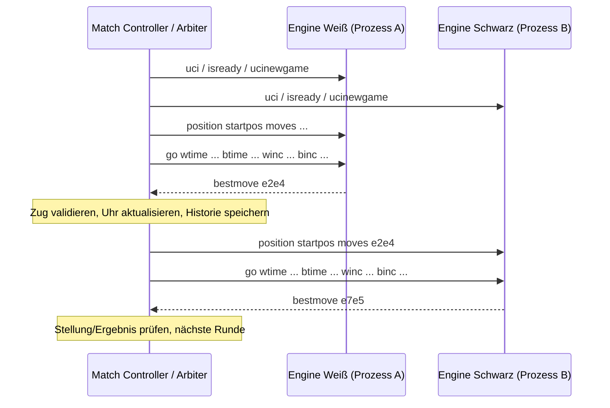

# SASD-AI-Chess – Kommunikations- und Dateiverträge

**Stand:** 27.10.2026 · **Status:** Soll-Spezifikation, noch nicht implementiert  
**Bezug:** [Architektur](ARCHITEKTUR.md), [Pflichtenheft](PFLICHTENHEFT.md).

## 1. UCI als Engine-Laufzeitschnittstelle

Universal Chess Interface (UCI) wird über **stdin/stdout** als zeilenorientierte Kommunikation verwendet. UCI ist **kein Peer-to-Peer-Spielprotokoll und kein TCP-Dienst**; zwei Engines benötigen einen Controller, der ihre Positionen und Spieluhren verwaltet.

**Minimaler Request-/Response-Ablauf (schematisch):**
```text
Controller -> Engine: uci
Engine     -> Controller: id name SASD-AI-Chess
Engine     -> Controller: id author SASD
Engine     -> Controller: uciok
Controller -> Engine: isready
Engine     -> Controller: readyok
Controller -> Engine: ucinewgame
Controller -> Engine: isready
Engine     -> Controller: readyok
Controller -> Engine: position startpos moves e2e4 e7e5
Controller -> Engine: go movetime 1000
Engine     -> Controller: info depth 1 score cp 12 nodes 20 pv g1f3
Engine     -> Controller: bestmove g1f3
```

Die Engine-Ausgaben sind **Beispieltext**, keine aktuellen Programmausgaben.

### 1.1 Pflichtkommandos / Semantik

| Kommando | Bedeutung | Randfall |
| --- | --- | --- |
| `uci` | Engine identifizieren, unterstützte Optionen ankündigen, `uciok` | keine anderen stdout-Protokolle |
| `isready` | vollständige Bereitschaft mit `readyok` melden | auch nach Optionswechsel |
| `ucinewgame` | neue Partie; Such-/Hashzustand korrekt behandeln | nicht selbst eine GUI-Partie leiten |
| `setoption name ... value ...` | deklarierte, gültige Optionen ändern | unbekannte/ungültige Optionen robust behandeln |
| `position startpos [moves ...]` | Position ab Start und gesamte Zugfolge rekonstruieren | Zuglegalität prüfen |
| `position fen <FEN> [moves ...]` | alternative Startposition | gültige FEN- und Move-Prüfung |
| `go depth/nodes/movetime/wtime/btime/winc/binc` | Suche mit Limit starten | Abbruch und Uhrmanagement |
| `stop` | laufende Suche abbrechen | genau eine finale `bestmove` im Suchlebenszyklus |
| `quit` | Suchthread stoppen und Prozess sauber beenden | kein Deadlock |

Optional `go infinite`, `ponder`, `UCI_Chess960` nur dann nutzen/melden, wenn funktional vollständig geprüft. Endstellung ohne legalen Zug: `bestmove 0000`. Keine `bestmove`-Antwort vor einem `go` erzeugen.

### 1.2 Ein-/Ausgabe und Fehler

- UCI-Zeilen begrenzen; EOF, ungültige Koordinaten, ungültige FEN und unbekannte Tokens behandeln.
- `stdout` enthält nur `id`/`option`/`uciok`/`readyok`/`info`/`bestmove` nach tatsächlicher Unterstützung. Debug → `stderr` oder gültige `info string`-Antwort.
- Reader darf während der Suche nicht blockiert sein; `stop` erfordert unterbrechbare Suche.
- UCI-Mehrfachkommando-/Race-Fälle erfordern expliziten Zustandsautomaten, keine losen nebenläufigen Writes.

## 2. Match-Controller und Selbstspiel



**Vertrag:** Match-Controller ist autoritativer Spielleiter und hält die gesamte Zugfolge sowie Zeitkontrollen. Engine-Prozesse kennen ihre eigene interne Suche; der Controller verlässt sich **nicht** blind auf deren Legalität. Zeitmessung monotone Uhr, getrennte Pipes, Limits für Info-Zeilen, Timeout/Crash/Fehlzug → strukturiertes Partieresultat. Derselbe ausführbare Pfad darf für Weiß und Schwarz verwendet werden, die Prozesse/State bleiben strikt getrennt.

**Match-Ergebnisfelder (Entwurf):** `match_id`, `game_id`, `engine_white`/`engine_black` mit Binär-/Modellhashes und UCI-Optionen; Anfangs-FEN; Eröffnungsquelle/Seed; Clock-Konfiguration; `moves_uci`, Bedenkzeiten, `result`, `termination_reason` und PGN-Pfad. JSON-Vertrag erst bei Implementierung mit `schema_version` fixieren.

## 3. PGN, SAN und FEN

**PGN:** Metadaten-Tags, Hauptzugfolge als SAN, Kommentare/Varianten, Ergebnistoken. Support für mehrere Partien je Datei; `SetUp=1`/`FEN` in zulässiger Variante.

```pgn
[Event "SASD Example"]
[Site "?"]
[Date "2026.10.27"]
[Round "?"]
[White "SASD-AI-Chess A"]
[Black "SASD-AI-Chess B"]
[Result "*"]

1. e4 e5 2. Nf3 Nc6 *
```

**FEN** beschreibt einen aktuellen Zustand, **nicht die vollständige Wiederholungshistorie**. Darum speichert `GameRecord` die Move-History zusätzlich. **PGN** ist kein Ersatz für UCI im laufenden Match.

**Parserkontrakt:** SAN nur vor dem Hintergrund der zugehörigen Stellung auflösen; illegale Züge zurückweisen; Meta-Elo und Ergebnis niemals als Schachregel verwenden; nicht unterstützte Varianten kennzeichnen; Quellen-/Lizenz-/Encoding-Provenienz speichern.

## 4. Trainingsdaten und Modellartefakte

- Jeder Dataset-Shard gehört zu einem Manifest mit `schema_version`, Dataset-/Quell-/Dateihashes, Lizenzauskunft, Split-Zuordnung, Filtern und Zählern.
- Stellungen und Labels sind getrennt: `PositionRecord` (FEN/Stellung, Zugrecht), `LabelRecord` (played_move, Ergebnis, CP, Mate, WDL plus Quelle/Perspektive/Depth).
- Train/Validation/Test gruppiert nach Partie und bekannten Duplikat-/Positionsclustern. Ein Label ohne bekannte Score-Perspektive darf nicht stillschweigend für NNUE-Training genutzt werden.
- Runtime-Modelle tragen `model_format_version` und `feature_schema_version`; inkompatible Versionen werden abgewiesen, nicht automatisch umgedeutet.

Weitere Regeln: [TRAINING.md](TRAINING.md) und [DATENQUELLEN.md](DATENQUELLEN.md).

## 5. Vertragstests und Versionswechsel

TC-UCI, TC-MATCH und TC-DATA aus [TESTKONZEPT.md](TESTKONZEPT.md) sind Norm der geplanten Implementierung. Protokoll-/Formatschemata nach erster Implementierung versionieren; inkompatible Änderungen erfordern ADR, Migrationsplan und Regressionstests. Remote-UCI-Transport ist **nicht** Teil der V1-Standardschnittstelle.
